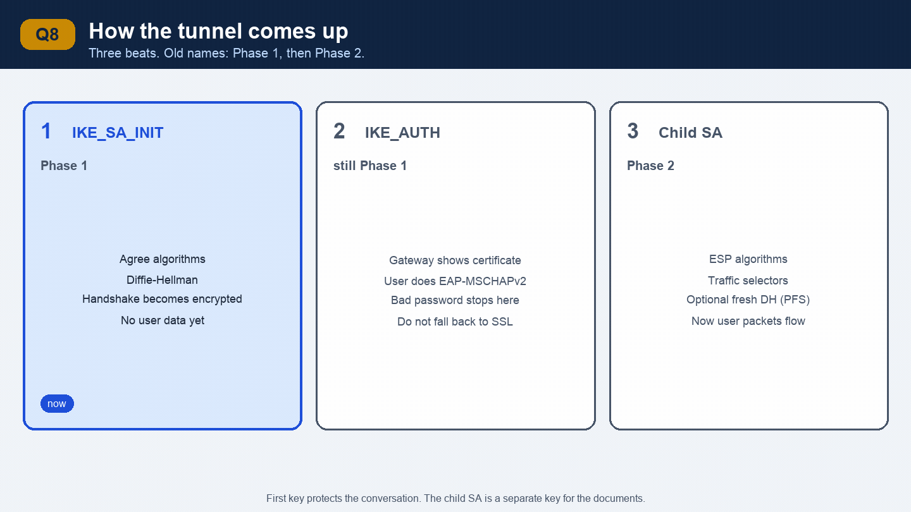
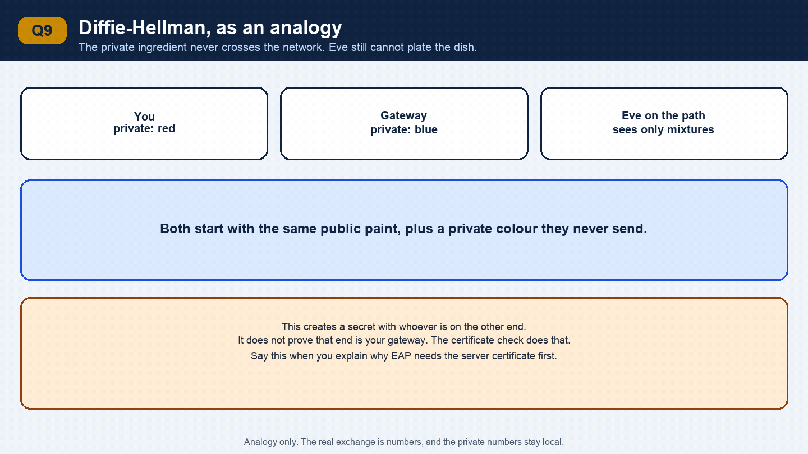
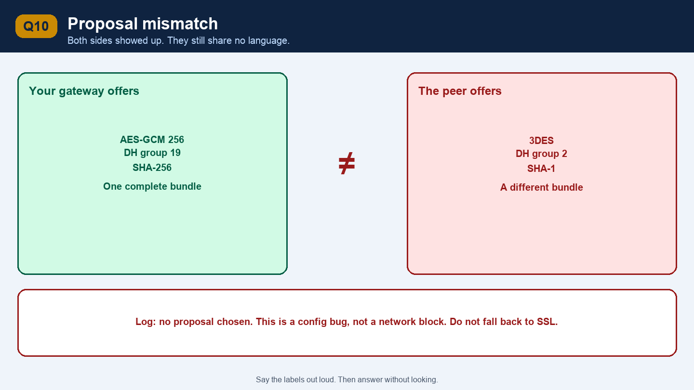
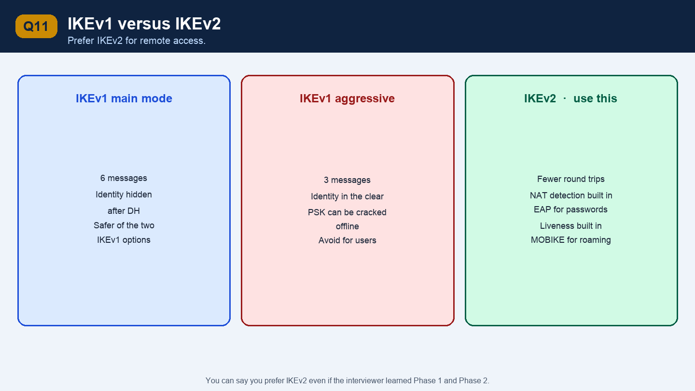
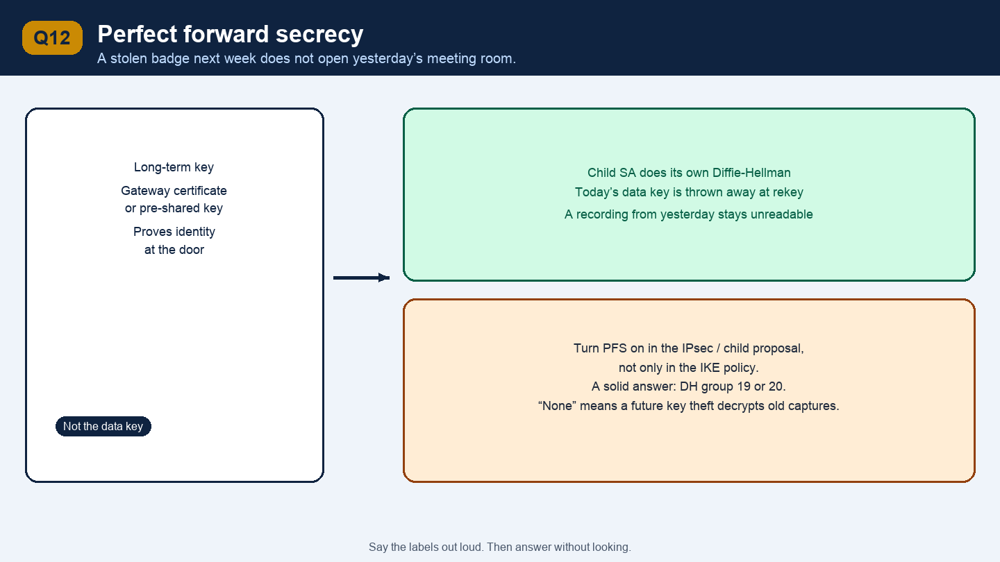
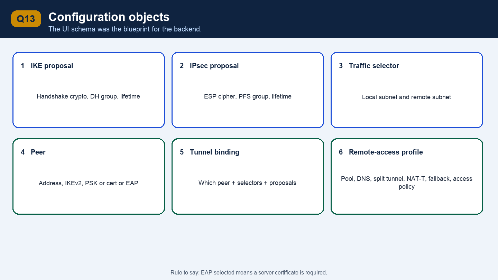

# Part 2 — How the tunnel is built

This is the middle of a networking interview. Draw it while you talk: two boxes, a handshake, then a data tunnel inside it.

```
Laptop                         BIG-IP gateway                 Internal app
  |                                  |                              |
  |  1. IKE on UDP 500 (or 4500)     |                              |
  |  ------------------------------> |                              |
  |  agree algorithms + Diffie-Hellman                              |
  |  prove identity (cert / EAP)     |                              |
  |                                  |                              |
  |  2. Child SA = the data tunnel   |                              |
  |  ==============================> |  3. decrypted inner packet   |
  |  outer: café IP -> gateway IP    | -------------------------->  |
  |  inner: 10.50.1.20 -> 10.1.1.50  |                              |
```

---

## Q8. Walk me through how an IPsec tunnel comes up



*This picture moves. Give each frame a couple of seconds and say what changed.*


**Short answer**

IKE runs first and builds a secure management channel. Inside that channel the peers prove who they are and agree on the data tunnel. Only then do user packets flow inside ESP.

**Explain it**

Say it as three beats. Interviewers who know IKEv2 use the official names. Interviewers who learned this years ago say Phase 1 and Phase 2. Give them both.

**Beat 1 — IKE_SA_INIT, also called Phase 1.**

The client sends the algorithms it supports, a Diffie-Hellman public value, and a random nonce. The gateway picks one algorithm set and sends its own public value and nonce. Both sides now compute the same shared secret and derive keys. From this moment the handshake itself is encrypted. No user data yet. This channel is the IKE SA.

**Beat 2 — IKE_AUTH.**

Each side proves its identity. For the resume feature the gateway proves itself with a certificate, and the user proves themselves with EAP-MSCHAPv2 (username and password). If this step fails, you do not build a tunnel and you do not fall back to SSL just to hide a bad password. The user has to see an authentication error.

**Beat 3 — Child SA, also called Phase 2 or Quick Mode.**

They agree on ESP algorithms, the traffic selectors, and optionally a fresh Diffie-Hellman exchange for perfect forward secrecy. This child SA is the tunnel that carries user packets. It has a lifetime. When it expires, they rekey, usually without bothering the user.

IKEv1 splits the same story into Phase 1 (the IKE SA) and Phase 2 (the IPsec SA). IKEv2 is what you want to say you implemented and prefer: fewer round trips, NAT detection built in, liveness checks built in, and EAP for username and password.

**Real-life example**

You book a private meeting room.

1. You and the office agree on a lock and each bring half of a key (Diffie-Hellman). The corridor outside cannot listen anymore.
2. At the door you check the office badge (server certificate) and they check your employee login (EAP).
3. Only then do you carry documents in (ESP). The documents are a separate locked bag, with its own key, inside the already private corridor.

**Follow-up: Why two stages? Why not encrypt the user data with the first key?**

The first key protects the conversation about the tunnel. The child SA is a separate key for the actual documents, with its own lifetime and its own selectors. You can rekey the documents every hour without repeating the user login. You can also have several child SAs under one login, for different subnets. And with a fresh Diffie-Hellman on the child SA, someone who later steals the gateway’s certificate still cannot decrypt traffic they recorded yesterday. That property is perfect forward secrecy.

---

## Q9. What is Diffie-Hellman doing in that handshake?



*This picture moves. Give each frame a couple of seconds and say what changed.*


**Short answer**

It lets two sides that have never shared a secret create one, while an eavesdropper on the path sees only public numbers and cannot compute the secret.

**Explain it**

The client picks a private number and sends a public value derived from it. The gateway does the same. Each side combines its own private number with the other side’s public value and both arrive at the same shared secret. The private numbers never cross the network.

That secret becomes the seed for the IKE encryption keys. It is not the user’s password. The password, if you use one, is checked later, inside this already encrypted channel.

A bigger **DH group** is a larger key space. Say this if they ask what you would allow in a UI:

| Group | What it is | What you say |
| --- | --- | --- |
| 14 | 2048-bit modular exponentiation | Acceptable minimum |
| 19, 20, 21 | Elliptic curve, 256 / 384 / 521 bit | Preferred. Strong and faster |
| 2 and 5 | 1024 and 1536 bit | Too small. The UI should warn or refuse |

**Real-life example**

You and a colleague are on a phone call that you suspect is overheard. You each think of a private ingredient. You describe a mixture that includes your ingredient, using a recipe an eavesdropper also knows. You each add the other’s mixture to your private ingredient and end up with the same dish. The eavesdropper heard both mixtures and still cannot plate that dish. That dish is the session key. It is thrown away when the SA expires, and the next call cooks a new one.

**Follow-up: If an attacker can sit in the middle, does Diffie-Hellman alone save you?**

No. An attacker who can intercept and modify the handshake can do Diffie-Hellman separately with you and with the gateway, and read everything. Diffie-Hellman creates a secret with *whoever is on the other end*. Identity proof is what tells you the other end is the real gateway. That is the certificate check in IKE_AUTH. This is the attack you must mention when you explain EAP: the password exchange is only safe if the client verified the gateway certificate first.

---

## Q10. What is a proposal, and why do tunnels fail when both sides are “configured”?




**Short answer**

A proposal is the list of algorithms you are willing to use. Both sides must share one complete match: encryption, integrity, DH group, and lifetime rules. If they do not, IKE fails before any user login.

**Explain it**

Each side sends one or more proposals. A proposal is a bundle, not a menu you mix freely. Example of a modern bundle:

- Encryption and integrity: **AES-GCM 256** (one algorithm does both)
- Key exchange: **DH group 19**
- PRF: SHA-256

Older bundles you should recognise and discourage: AES-CBC plus HMAC-SHA1, 3DES, MD5, DH group 2.

The gateway picks the first proposal it also supports. If nothing overlaps, the log says something like “no proposal chosen.” The tunnel is down. This is a configuration bug, not a network bug. Your SSL fallback must not hide it. Falling back would just fail again at the next layer and waste the user’s time, or worse, mask a weak-crypto mismatch you needed to see.

**Real-life example**

Two people agree to meet and each lists languages they speak. One lists Telugu and English. The other lists Hindi only. Both showed up. The meeting still cannot happen. A proposal mismatch is that meeting.

**Follow-up: What would your UI do so an admin does not create this bug?**

The schema separates an IKE proposal from an IPsec (child) proposal, because the handshake and the data tunnel can use different algorithms. The UI offers a default “secure” set (AES-GCM, group 19 or 20) and puts legacy algorithms behind a warning. It also shows the peer’s expected proposal next to yours when the negotiation fails, so the admin sees the mismatch instead of a generic “tunnel down.”

---

## Q11. What is IKEv1 main mode versus aggressive mode, and why do you prefer IKEv2?




**Short answer**

IKEv1 main mode takes six messages and hides identities. Aggressive mode takes three and reveals the identity, and with a pre-shared key it can be cracked offline. IKEv2 replaces both: fewer messages, identity protected, NAT and EAP designed in.

**Explain it**

You may never have implemented IKEv1. You still need this answer, because many interviewers learned IPsec from IKEv1.

**Main mode** is six messages. Algorithms, then Diffie-Hellman, then identities and authentication inside the encrypted channel. Safer. Does not work cleanly when the responder has many pre-shared keys and cannot tell who is calling before the identity is revealed.

**Aggressive mode** squeezes the start into three messages. The identity is sent early, in the clear. If authentication is a pre-shared key, an attacker who records the handshake can try passwords offline. Remote-access deployments that used aggressive mode plus a shared group password were a common weakness.

**IKEv2** is what BIG-IP remote access should be described as:

- One round trip to establish the IKE SA, one to authenticate and create the child SA.
- NAT detection is part of the protocol.
- EAP is part of the protocol, so username and password fit without a custom hack.
- Liveness (“are you still there?”) is part of the protocol. IKEv1 bolted this on later as Dead Peer Detection.
- MOBIKE lets a laptop change its IP, for example Wi-Fi to LTE, and update the existing IKE SA instead of starting a full login again.

**Real-life example**

Main mode is exchanging ID cards only after you are inside a closed office. Aggressive mode is shouting your employee ID across the lobby so the meeting can start faster. IKEv2 is a badge reader at a door that already has a proper lobby: quick, and the lobby is not a public announcement.

**Follow-up: What is Dead Peer Detection for?**

A laptop sleeps, or the user walks out of Wi-Fi range, and never sends a “delete this SA” message. The gateway still thinks the tunnel is up and may keep state, or the client thinks the tunnel is up and black-holes traffic. DPD sends a small liveness check. If the peer does not answer, the SA is deleted and the next packet builds a fresh one. On flaky café Wi-Fi, an aggressive timer causes flapping. A patient timer leaves a dead tunnel in place. The UI exposes the interval for that reason.

---

## Q12. What is perfect forward secrecy?




**Short answer**

Perfect forward secrecy means the data-tunnel keys come from their own Diffie-Hellman exchange. If someone later steals the gateway certificate or the pre-shared key, they still cannot decrypt sessions they recorded in the past.

**Explain it**

Without PFS, the long-term key is involved in deriving the session keys. An attacker records encrypted traffic today, steals the certificate private key next month, and decrypts the recording.

With PFS, the child SA runs a new Diffie-Hellman. The long-term key was only used to prove identity. The session keys were never stored and cannot be recomputed from the stolen certificate. Each rekey starts another fresh secret, so one stolen session key does not open the previous hour either.

There is a cost. Extra Diffie-Hellman on every child SA uses CPU. For a VPN gateway with many users that cost is accepted, because recorded traffic is the thing you are protecting.

**Real-life example**

Your office badge (the certificate) only gets you past the receptionist. Every meeting room still has its own throwaway lock. If someone copies your badge next week, they can enter the building next week. They cannot open yesterday’s meeting room. The lock was changed and the key was thrown away.

**Follow-up: Where do you turn PFS on?**

On the child SA, sometimes called the IPsec policy or the PFS group, not on the IKE policy alone. The UI field is a DH group for the data tunnel. Group 19 or 20 is a solid answer. If the admin sets it to “none,” you are explicitly accepting that a future key theft decrypts old captures.

---

## Q13. What did the configuration model look like?




**Short answer**

I split the config into objects an admin already thinks in: IKE policy, IPsec policy, traffic selector, peer, and a remote-access profile that binds them and points at an access policy. The UI was the blueprint. Backend work filled in those objects instead of inventing a second shape later.

**Explain it**

This is the “I designed the UI and the schema” bullet. Walk the objects in the order an admin fills them in. You do not need internal class names. You need the fields and the rules between them.

| Object | What the admin sets | Why it is its own object |
| --- | --- | --- |
| IKE proposal | Encryption, integrity or PRF, DH group, lifetime | Reused by many peers. This is the handshake crypto |
| IPsec proposal | ESP algorithm, PFS group, lifetime | Data-tunnel crypto. Often rotated on a different schedule from IKE |
| Traffic selector | Local subnet, remote subnet, optional protocol and port | Defines interesting traffic. A mismatch here is the classic “IKE is up, ping fails” bug |
| Peer / gateway | Address or hostname, IKEv2, my identity, auth method | Auth method is certificate, pre-shared key, or EAP |
| Tunnel binding | Which peer, which selectors, which proposals | One place that says “this is a tunnel” |
| Remote-access profile | Address pool, DNS, split-tunnel list, DPD, NAT-T, fallback to SSL, access policy name | The part a laptop user needs and a site-to-site tunnel does not |

Rules the UI should enforce, because they prevent support calls:

- EAP selected means a server certificate is required. The password is only safe after the client has authenticated the gateway.
- NAT-T defaults to on for remote access. Turning it off shows a warning that users behind home routers will fail.
- Child SA lifetime is shorter than the IKE lifetime, so the data keys rotate while the login stays up.
- Weak algorithms can be saved only with an explicit warning.
- The two sides of a site-to-site tunnel must mirror selectors. The local subnet on one side is the remote subnet on the other.

**Real-life example**

Think of a flight booking. The aircraft type (IKE proposal), the fare rules (IPsec proposal), the route (traffic selector), and the passenger’s ID check (peer auth and access policy) are separate forms. The ticket (tunnel binding plus remote-access profile) references them. If you stuff all of that into one form, every new option breaks the form, and every team invents its own copy. A schema of separate objects let the backend teams implement one piece at a time against a stable blueprint.

**Follow-up: What is a traffic-selector mismatch, in one story?**

Hyderabad says “I will send you `10.1.0.0/16`, I expect `10.2.0.0/16` back.” Mumbai is configured with `10.2.0.0/24` by mistake. IKE may complete, and the child SA is refused or only covers the smaller subnet. Hosts in `10.2.1.0/24` are silently outside the tunnel. The fix is to make the selectors exact mirrors, which is why the UI should show both sides together.

---

### Checkpoint

1. Name the three beats: IKE_SA_INIT, IKE_AUTH, Child SA. Give the old Phase 1 / Phase 2 names too.
2. What does Diffie-Hellman give you, and what does it not give you?
3. What is PFS, in the badge-and-meeting-room story?
4. Which fields live on the remote-access profile, and which rule forces a server certificate when EAP is on?
