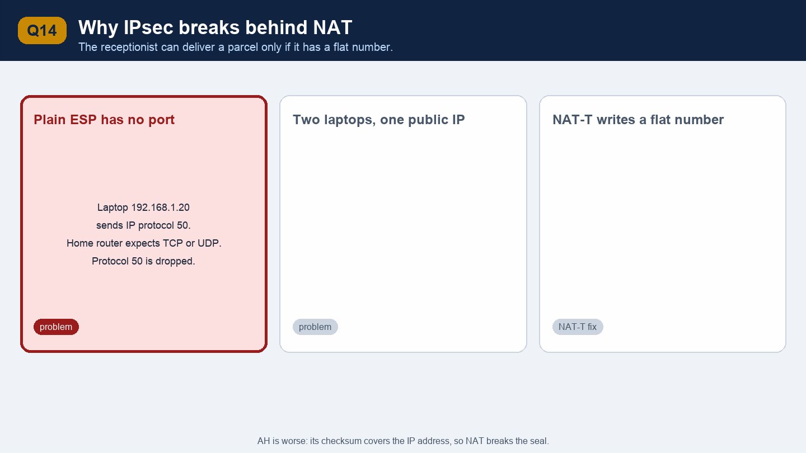
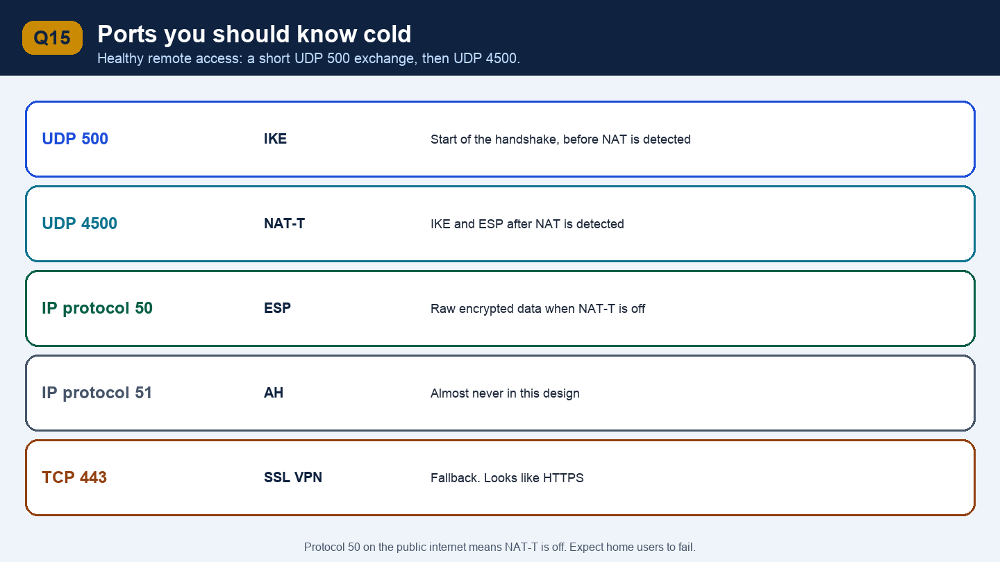
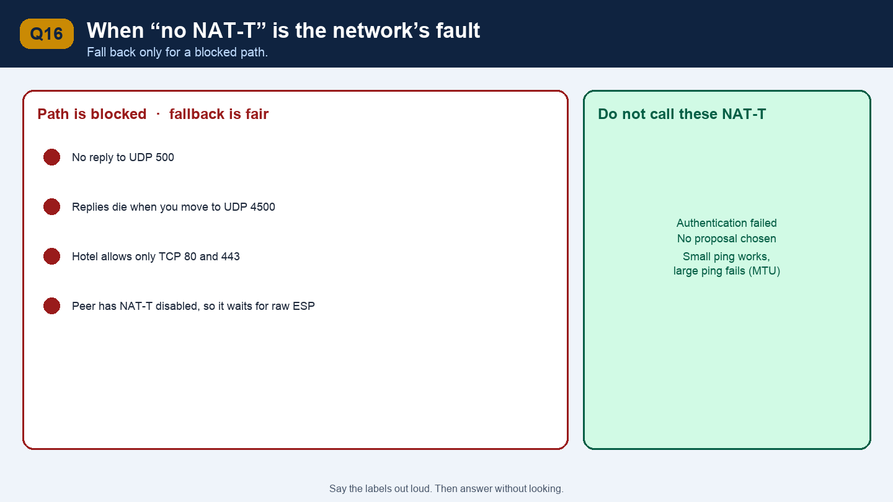
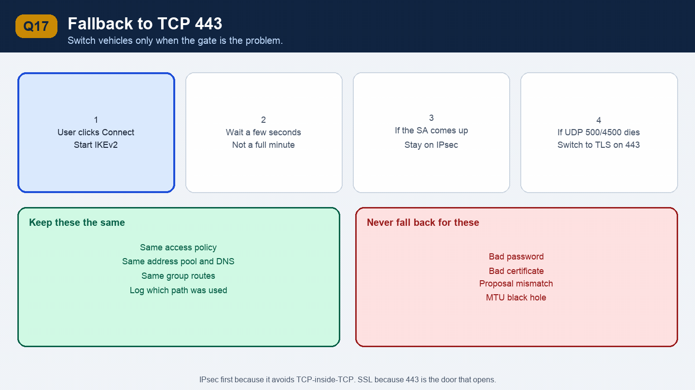
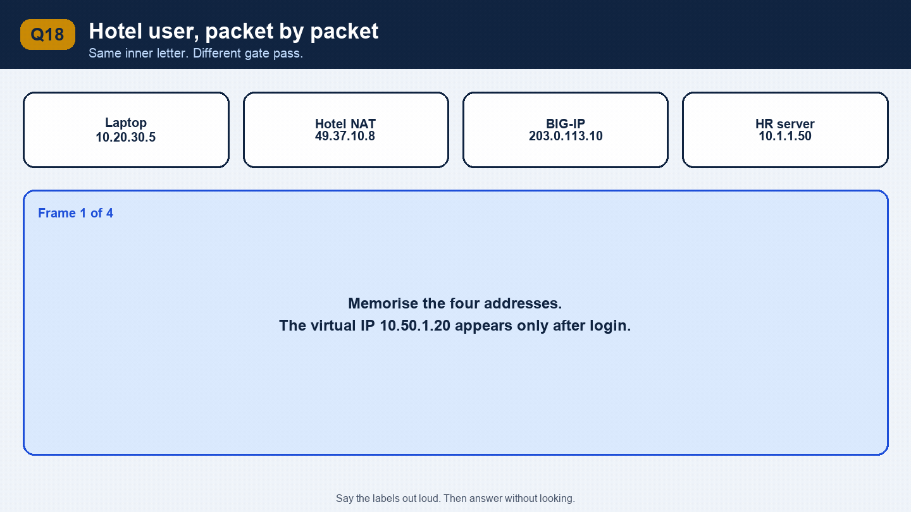

# Part 3 — NAT-T and the SSL fallback

This is the resume bullet:

> Engineered a seamless, automatic fallback mechanism from IPsec VPN to SSL VPN on port 443, for users behind restrictive guest firewalls or routers that lack NAT-T support.

Interviewers will ask you to explain the failure, then the fallback, then when you must **not** fall back.

---

## Q14. Why does IPsec break behind NAT?

*This picture moves. Give each frame a couple of seconds and say what changed.*

**Short answer**

Home and hotel routers rewrite source addresses. Plain ESP has no TCP or UDP port, so many of those routers drop it or cannot tell two laptops apart. NAT-T fixes that by wrapping ESP inside UDP port 4500. If the router or a firewall still blocks UDP 500 and 4500, IPsec cannot come up.

**Explain it**

Most remote users are behind NAT. The laptop has a private address such as `192.168.1.20`. The router replaces that with the house’s one public IP when the packet leaves, and it remembers the mapping so replies come back.

That mapping is easy for TCP and UDP because they have port numbers. ESP is IP protocol 50. It has an SPI, not a port. Three things go wrong:

1. **The router drops it.** A lot of consumer routers and almost all guest firewalls only forward TCP and UDP. Protocol 50 never leaves the building.
2. **The router cannot tell users apart.** Two laptops in the same hotel share one public IP. With UDP, different source ports keep them separate. With plain ESP, the router may keep only one mapping and the second user steals or breaks the first.
3. **AH is worse.** AH’s checksum covers the IP addresses. NAT changes the address, the checksum fails, and the gateway drops the packet. This is another reason production tunnels use ESP.

ESP itself does not checksum the outer IP addresses, so a single user and a smart NAT can sometimes pass plain ESP. You do not design for that. You design for NAT-T.

**Real-life example**

An apartment building has one street address and many flats. The receptionist (NAT) can deliver a parcel only if the parcel has a flat number (a UDP port). Plain ESP is a parcel with a street address and no flat number. Two residents order the same courier. The receptionist does not know which flat gets which parcel.

NAT-T writes a flat number on the parcel by putting ESP inside UDP. The receptionist can do the job they already know how to do.

**Follow-up: What is NAT-T, exactly?**

NAT Traversal, often said as “nat-tee.”

During IKE, each side sends a hash of the IP address and port it thinks it is using. Each side also hashes the address and port it actually sees on the packet. If those hashes differ, something in the middle rewrote the header. NAT is present.

Once NAT is detected:

- IKE itself moves from UDP 500 to UDP 4500.
- ESP is wrapped inside UDP 4500. The packet is now a normal UDP packet. The router rewrites the source port and keeps a mapping.
- A small marker distinguishes an IKE message from an ESP packet, because both now arrive on 4500. IKE uses a four-byte marker of zeros. ESP starts with a non-zero SPI.

The gateway uses that UDP source port as the demultiplexer, so two laptops behind the same hotel can both stay up.

**Follow-up: The tunnel works for a minute, then dies. What happened?**

NAT mappings expire. Many routers forget a UDP flow after 30 to 120 seconds of silence. The next packet from the gateway arrives at the hotel and the hotel no longer knows which laptop it belonged to. NAT-T sends a short keepalive on UDP 4500 (a one-byte packet is enough) more often than the router’s timeout. If keepalives are missing or too slow, the symptom is exactly “it connects, I get one page, then it hangs until I reconnect.”

---

## Q15. Which ports should I be able to list without thinking?

**Short answer**

UDP 500 for IKE, UDP 4500 for NAT-T, IP protocol 50 for ESP, and TCP 443 for the SSL fallback.

**Explain it**

| Traffic | Port or protocol | When you see it |
| --- | --- | --- |
| IKE | UDP 500 | The start of the handshake, before NAT is detected |
| NAT-T | UDP 4500 | IKE and ESP after NAT is detected |
| ESP | IP protocol 50 | Data, when NAT-T is off |
| AH | IP protocol 51 | Almost never in this design |
| SSL VPN | TCP 443 | Fallback path. Looks like HTTPS |

On a packet capture of a healthy remote-access session you see a short exchange on UDP 500, then the rest of the session on UDP 4500. If you see protocol 50 on the public internet, NAT-T is off, and you should expect failures from home users.

**Real-life example**

UDP 500 is the front desk phone number. Once the hotel receptionist is involved, everyone moves the conversation to extension 4500 so the receptionist can transfer calls back to the right room. Port 443 is the public website door you use when the hotel has unplugged the phone system and only left web browsing working.

**Follow-up: Why are 500 and 4500 UDP and not TCP?**

IKE is a short request-response handshake, and ESP already has its own sequence numbers and reliability is left to the application’s TCP. Putting that inside UDP avoids a second TCP stack. It also avoids the TCP-meltdown problem you get with SSL VPN. The cost is that a firewall admin who allows “web only” has just blocked you. That cost is the reason the fallback exists.

---

## Q16. What does “the router does not support NAT-T” mean for the user?

**Short answer**

The laptop and the gateway are ready to use UDP 4500, and something on the path still will not pass it. Often the guest firewall allows only TCP 80 and 443. Sometimes an old router corrupts or drops UDP encapsulation. From the client’s point of view the handshake never completes.

**Explain it**

NAT-T is a property of the VPN peers, and it is also at the mercy of the network between them. Your gateway can have NAT-T on, and the user can still fail:

- Airport, hotel, and café Wi-Fi often allow TCP 443 and block UDP.
- Some corporate guest networks do the same on purpose.
- A middlebox that rewrites or drops UDP, or that allows 500 and blocks 4500, leaves the client stuck after NAT detection.
- A peer configured with NAT-T disabled will refuse the move to 4500. One side encapsulation and the other side raw ESP means each side is waiting for a packet shape the other will never send.

The user-visible result is the same. The VPN spinner runs, then times out. The internal app never loads. The user does not know what a UDP port is, and they should not have to.

**Real-life example**

You have a scooter that is legal on the road (NAT-T is implemented). The office park you are visiting has a gate that only lifts for cars with a website-looking pass (TCP 443). Arguing that the scooter follows the NAT-T specification does not lift the gate. You need a second vehicle that the gate already accepts.

**Follow-up: How do you tell “NAT-T is blocked” from “the password is wrong”?**

Watch where the handshake dies.

- No reply to UDP 500, or replies that stop the moment you move to 4500: the path is blocked. This is a fallback case.
- IKE_SA_INIT completes and IKE_AUTH fails with an authentication error: the path is fine. The user, the certificate, or the access policy is wrong. Do not fall back. Show the error.
- “No proposal chosen”: configuration bug. Do not fall back.
- Tunnel comes up and large pages hang while ping works: suspect MTU, not NAT-T. Do not fall back. Clamp the TCP MSS or lower the tunnel MTU.

The whole design of the fallback is this distinction. A fallback that treats every failure as “try SSL” hides misconfiguration and turns a bad password into a confusing second login.

---

## Q17. Why fall back to SSL VPN on port 443?

*This picture moves. Give each frame a couple of seconds and say what changed.*

**Short answer**

TCP 443 is the one port almost every network allows, because blocking it would break the web. The client tries IPsec, and if the network is the thing that failed, it brings up the same kind of remote-access session over TLS. The user reaches internal apps either way.

**Explain it**

Walk the client behavior as a sequence you designed, not as a slogan.

1. The user clicks Connect. The client starts IKEv2 toward the gateway.
2. You wait a bounded time. A few seconds, not a minute. The user is staring at a spinner.
3. If the IKE SA and child SA come up, you stay on IPsec. This is the preferred path: kernel encryption, UDP, no TCP meltdown.
4. If UDP 500 or 4500 times out, or the peer cannot do NAT-T, you stop IKE and start the SSL VPN on TCP 443.
5. The SSL VPN still gives the laptop a virtual adapter, an address from the same style of pool, DNS, and split-tunnel routes. Applications do not change.
6. The access policy is the same one. The user should not learn a second password ritual because they sat down in a hotel.

Why 443 specifically? Guest networks, HTTP proxies, and “secure web gateway” products are built to pass HTTPS. A VPN that looks like HTTPS passes with them. A VPN that looks like UDP 4500 does not.

Why try IPsec at all, if 443 always works? On home broadband and corporate networks, IPsec connects quickly and carries heavy traffic with less overhead. SSL VPN remains the escape hatch. Prefer the fast path, keep the universal path.

**Real-life example**

You send a document by motorcycle courier because it is faster (IPsec). If the gate refuses motorcycles, the same office sends the same document in a normal web-delivery truck (TLS on 443). The recipient at the company desk gets the document either way and does not care which vehicle cleared the gate. The sender only switches vehicles when the gate is the problem. A wrong office address (bad password, bad certificate) is not a reason to switch vehicles. You would just deliver the failure to the wrong place faster.

**Follow-up: What should the user see?**

Almost nothing, if the reason was the network. “Connected” is the success state for both paths. In the client details or the gateway log you still record which path was used, because support will ask. If you hide that, every ticket looks like “VPN is slow today” and nobody knows they are on the fallback.

A small non-blocking note such as “Connected over HTTPS because the network blocks IPsec” is enough for a helpdesk. A modal popup in the user’s face on every hotel visit is not seamless.

**Follow-up: What did you have to keep the same across both paths so the fallback feels seamless?**

- The same user authentication outcome. If IPsec failed before login, SSL VPN runs the access policy. If you can reuse a completed login, even better. Do not make the user type the password twice because UDP was blocked.
- The same address pool and DNS. Apps and split-tunnel routes must not change meaning between paths.
- The same group-based access control after the tunnel is up. Falling back to SSL must not grant a wider set of internal networks.
- A hard rule on which errors are eligible. Connectivity and NAT-T only.

---

## Q18. An interviewer says “Walk me through a hotel user, packet by packet.”

*This picture moves. Give each frame a couple of seconds and say what changed.*

**Short answer**

Tell one story with real addresses, from the click to the internal website, including the moment the hotel blocks you and the client switches to 443.

**Explain it**

Use these addresses so you do not invent new ones under pressure.

- Laptop on hotel Wi-Fi: `10.20.30.5`
- Hotel public IP: `49.37.10.8`
- BIG-IP public IP: `203.0.113.10`
- Virtual IP the gateway will assign: `10.50.1.20`
- Internal HR server: `10.1.1.50`

**Attempt 1 — IPsec**

1. The client sends IKE to `203.0.113.10` UDP 500. The hotel rewrites the source from `10.20.30.5` to `49.37.10.8`.
2. The gateway’s reply is dropped by the hotel firewall, or UDP 4500 is dropped after NAT detection. The client’s timer fires.
3. The client classifies this as a path failure.

**Attempt 2 — SSL VPN**

4. The client opens TLS to `203.0.113.10` TCP 443. The hotel allows it because it looks like HTTPS.
5. The user authenticates through the APM access policy. Same directory account they would have used for EAP.
6. The gateway assigns `10.50.1.20`, pushes internal DNS, and installs routes for the company subnets.
7. The user opens `https://hr.corp.example`. DNS returns `10.1.1.50`.
8. The laptop builds an IP packet from `10.50.1.20` to `10.1.1.50` and carries it inside the TLS session. The outer packet is `49.37.10.8` → `203.0.113.10`, TCP 443.
9. BIG-IP terminates TLS, checks that this user may reach the HR subnet, and forwards the inner packet. The reply returns by the same session. The hotel’s NAT mapping for TCP 443 delivers it to the laptop.

**If the hotel had allowed IPsec**, steps 4 and 5 are replaced by IKE_AUTH plus a child SA, and step 8 is ESP inside UDP 4500 instead of TLS. The inner packet is identical. That sentence is the one that shows you understand the fallback: same inner network, different outer transport.

**Real-life example**

The hotel is a gated township. The inner packet is a letter addressed from your assigned desk (`10.50.1.20`) to HR (`10.1.1.50`). The outer packet is the township gate pass. IPsec’s gate pass is a courier badge the guard does not recognise. The SSL gate pass is a normal visitor sticker for the web entrance. HR still receives a letter from your desk number.

**Follow-up: Ping works, and the HR page spins forever. Now what?**

The tunnel is up. Small packets fit. Large packets do not. IPsec and TLS both add headers, so a 1500-byte packet no longer fits on an Ethernet path that is already 1500 bytes. If the Don’t Fragment bit is set, the packet is dropped, and if the ICMP “fragmentation needed” message is also dropped, the sender never learns. This is a PMTU black hole.

What you say you would do:

- Lower the tunnel MTU, often into the 1350–1400 range when UDP 4500 is in use.
- Clamp TCP MSS on the gateway so laptops advertise a smaller segment and never send the oversized packet.
- Confirm with a growing ping. `ping` with a small size works. `ping` with 1400 bytes fails. That pattern is the signature.

This failure is not a reason to fall back from a working IPsec tunnel to SSL. SSL has overhead too. You fix the MTU.

---

### Checkpoint

1. Why does plain ESP suffer behind a hotel router?
2. What changes when NAT-T is detected?
3. Which failures may trigger SSL fallback, and which must not?
4. Tell the hotel story with the five IP addresses above, without looking.
