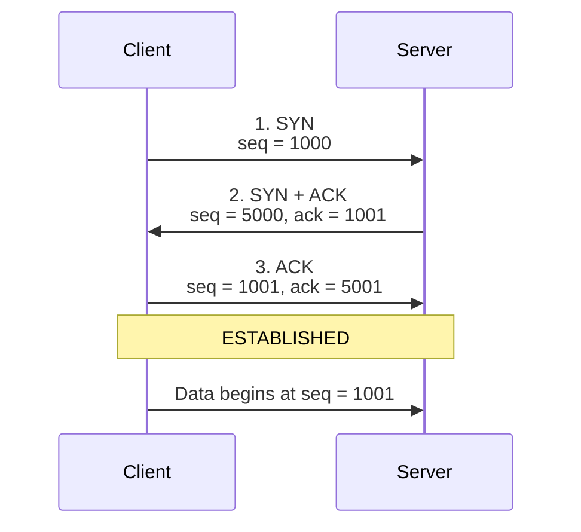

# Network Questions

## TCP 3-Way Handshake

Reference: [TCP 3-Way Handshake Process (GeeksforGeeks)](https://www.geeksforgeeks.org/computer-networks/tcp-3-way-handshake-process/)

The TCP 3-way handshake is how a client and a server agree they can both send and receive before any real data moves. Each side picks a starting sequence number, and the other side repeats it back so both know the numbers arrived.

### Simple example

Think of calling a friend before you start talking.

1. **You:** "Can you hear me? I will start my sentences at number 1000."
2. **Friend:** "I hear you. I expect 1001 next. I will start my sentences at 5000."
3. **You:** "I hear you. I expect 5001 next. We can talk."

Until step 3, your friend does not know that you received their number. After step 3, both people know the line works in both directions.

### Sequence diagram

The client starts at sequence number **1000**. The server starts at **5000**. Each SYN is acknowledged as that number plus one, because the SYN flag itself uses one sequence number.

Read it top to bottom. The client proposes 1000. The server accepts it by asking for 1001, and proposes 5000. The client accepts that by asking for 5001. Only then does application data start.

### The three steps

| Step | Who sends | Flags | Sequence | Acknowledgment | Meaning |
| --- | --- | --- | --- | --- | --- |
| 1 | Client → server | SYN | 1000 | none | "I want a connection. My first number is 1000." |
| 2 | Server → client | SYN + ACK | 5000 | 1001 | "I got 1000. Send 1001 next. My first number is 5000." |
| 3 | Client → server | ACK | 1001 | 5001 | "I got 5000. Send 5001 next." |

The connection is now **ESTABLISHED**. The next real byte from the client uses sequence number 1001.

SYN and the acknowledgment are one number apart because the SYN flag itself consumes one sequence number. It is counted like one byte, even though no application data was sent. That is why 1000 is acknowledged as 1001, and 5000 as 5001.

### Flags

| Flag | Purpose |
| --- | --- |
| SYN | Starts the connection and sends that side's initial sequence number. |
| ACK | Confirms the sequence number just received. |
| SYN + ACK | The server accepts the client's number and sends its own initial sequence number in the same segment. |

### What to say in the interview

> TCP is connection-oriented, so before data is sent it does a 3-way handshake. The client sends SYN with its initial sequence number. The server replies SYN-ACK: ACK means "I got yours, send the next number," and SYN shares the server's own initial sequence number. The client sends a final ACK for the server's number. Each direction has its own sequence space, so both sides must announce a number and hear it acknowledged. After that, the connection is established and data transfer starts.

When you tap **Watch Live**, this handshake finishes at the transport layer before the video request is sent. UDP skips the handshake, which is why UDP is faster and also why a lost UDP packet is simply gone.

### Why it takes three steps

Step 2 tells the client that the server is up and shares the server's sequence number. Step 3 tells the server that the client received that number. Both directions are confirmed only after the third message.
