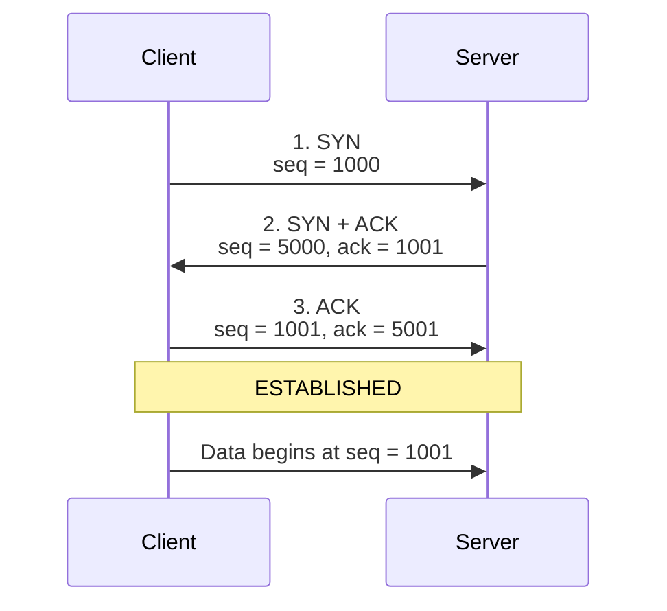
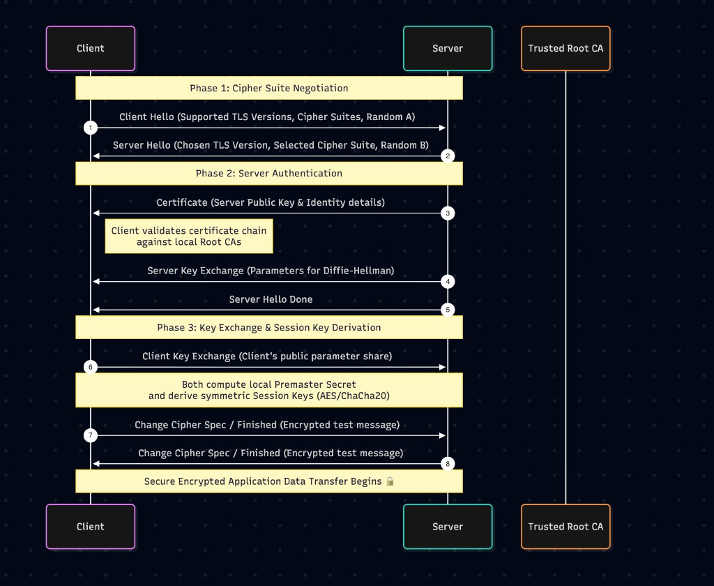

# Network Questions

## TCP 3-Way Handshake

Reference: [TCP 3-Way Handshake Process (GeeksforGeeks)](https://www.geeksforgeeks.org/computer-networks/tcp-3-way-handshake-process/)

The TCP 3-way handshake is how a client and a server agree they can both send and receive before any real data moves. Each side picks a starting sequence number, and the other side repeats it back so both know the numbers arrived.

### Simple example

Think of calling a friend before you start talking.

1. **You:** "Can you hear me? I will start my sentences at number 1000."
2. **Friend:** "I hear you. I expect 1001 next. I will start my sentences at 5000."
3. **You:** "I hear you. I expect 5001 next. We can talk."

Until step 3, your friend does not know that you received their number. After step 3, both people know the line works in both directions.

### Sequence diagram

The client starts at sequence number **1000**. The server starts at **5000**. Each SYN is acknowledged as that number plus one, because the SYN flag itself uses one sequence number.

Read it top to bottom. The client proposes 1000. The server accepts it by asking for 1001, and proposes 5000. The client accepts that by asking for 5001. Only then does application data start.

### The three steps

| Step | Who sends | Flags | Sequence | Acknowledgment | Meaning |
| --- | --- | --- | --- | --- | --- |
| 1 | Client → server | SYN | 1000 | none | "I want a connection. My first number is 1000." |
| 2 | Server → client | SYN + ACK | 5000 | 1001 | "I got 1000. Send 1001 next. My first number is 5000." |
| 3 | Client → server | ACK | 1001 | 5001 | "I got 5000. Send 5001 next." |

The connection is now **ESTABLISHED**. The next real byte from the client uses sequence number 1001.

SYN and the acknowledgment are one number apart because the SYN flag itself consumes one sequence number. It is counted like one byte, even though no application data was sent. That is why 1000 is acknowledged as 1001, and 5000 as 5001.

### Flags

| Flag | Purpose |
| --- | --- |
| SYN | Starts the connection and sends that side's initial sequence number. |
| ACK | Confirms the sequence number just received. |
| SYN + ACK | The server accepts the client's number and sends its own initial sequence number in the same segment. |

### What to say in the interview

> TCP is connection-oriented, so before data is sent it does a 3-way handshake. The client sends SYN with its initial sequence number. The server replies SYN-ACK: ACK means "I got yours, send the next number," and SYN shares the server's own initial sequence number. The client sends a final ACK for the server's number. Each direction has its own sequence space, so both sides must announce a number and hear it acknowledged. After that, the connection is established and data transfer starts.

When you tap **Watch Live**, this handshake finishes at the transport layer before the video request is sent. UDP skips the handshake, which is why UDP is faster and also why a lost UDP packet is simply gone.

### Why it takes three steps

Step 2 tells the client that the server is up and shares the server's sequence number. Step 3 tells the server that the client received that number. Both directions are confirmed only after the third message.

## TLS handshake (HTTPS)

What happens under the hood when a client establishes a TLS handshake with a secure web server, and how do the two sides negotiate encryption algorithms and verify identity?

### 1. Cipher Suite Negotiation

A cipher suite is a specific set of cryptographic algorithms bundled together to secure a network connection. During the handshake, the client and server must agree on a common suite they both support.

A TLS 1.2 suite name such as `TLS_ECDHE_RSA_WITH_AES_256_GCM_SHA384` tells you the pieces that secure the connection:

| Piece | Example in that name | Job |
| --- | --- | --- |
| Protocol | TLS | Transport Layer Security. |
| Key exchange | ECDHE | Elliptic Curve Diffie-Hellman Ephemeral. Used to establish a shared secret for this connection only. |
| Authentication | RSA | How the server's certificate is signed, so the client can check identity. |
| Bulk encryption | AES-256-GCM | AES-256 in Galois/Counter Mode. Encrypts the actual data stream. |
| Hash | SHA-384 | Integrity check, so a change to the data in transit is detected. |

TLS 1.3 shortens the suite name to something like `TLS_AES_256_GCM_SHA384`. The key exchange is agreed separately, and the name keeps the bulk cipher and the hash.

The client sends every cipher suite it supports, in preference order, inside Client Hello, along with the TLS versions it supports and a random value (Random A). The server inspects that list, picks the strongest suite it also supports, and returns that one choice in Server Hello, with the chosen TLS version and its own random value (Random B).

### 2. Server Authentication

Once the cipher suite is locked in, the server must prove its identity so the client does not send sensitive data to an attacker. This is what blocks a man-in-the-middle.

The server sends an X.509 digital certificate containing its domain name, organization details, and public key. On the diagram this is message 3. The client does not call the Trusted Root CA during the handshake. It validates the certificate against the root certificates already installed in the operating system or browser trust store (DigiCert, Let's Encrypt, Sectigo, and others).

The client checks three things:

1. The certificate is currently valid: not expired and not revoked.
2. The domain name matches the website the user is trying to visit.
3. The signature can be traced through any intermediate CAs back to a trusted root CA.

If the chosen suite uses ephemeral Diffie-Hellman, the server also sends Server Key Exchange (message 4) with its Diffie-Hellman parameters, then Server Hello Done (message 5).

### 3. Key Exchange and Session Key Derivation

Asymmetric cryptography (public/private key pairs) is expensive, so it is used only at the start to establish trust and exchange keys. After that, fast symmetric cryptography carries the data.

With ECDHE, both sides use an ephemeral Diffie-Hellman exchange. The client sends its public parameter share in Client Key Exchange (message 6). An attacker who records every packet still cannot compute the shared secret, because neither side transmits its private key or the final secret.

Both sides then combine that premaster secret with Random A and Random B and independently compute the same symmetric session keys (AES or ChaCha20). Each side sends Change Cipher Spec and an encrypted Finished message (messages 7 and 8). If the other side can decrypt that Finished message, both parties derived the same keys and the encrypted tunnel is open. Application data is encrypted from that point on.
