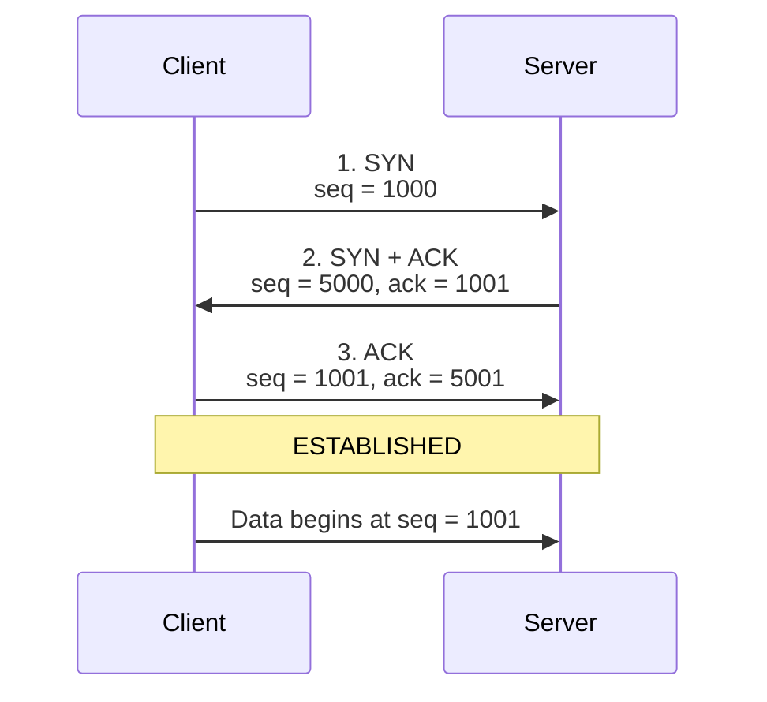
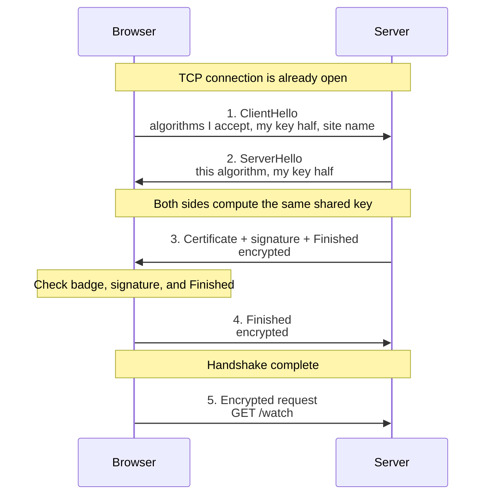

# Network Questions

## TCP 3-Way Handshake

Reference: [TCP 3-Way Handshake Process (GeeksforGeeks)](https://www.geeksforgeeks.org/computer-networks/tcp-3-way-handshake-process/)

The TCP 3-way handshake is how a client and a server agree they can both send and receive before any real data moves. Each side picks a starting sequence number, and the other side repeats it back so both know the numbers arrived.

### Simple example

Think of calling a friend before you start talking.

1. **You:** "Can you hear me? I will start my sentences at number 1000."
2. **Friend:** "I hear you. I expect 1001 next. I will start my sentences at 5000."
3. **You:** "I hear you. I expect 5001 next. We can talk."

Until step 3, your friend does not know that you received their number. After step 3, both people know the line works in both directions.

### Sequence diagram

The client starts at sequence number **1000**. The server starts at **5000**. Each SYN is acknowledged as that number plus one, because the SYN flag itself uses one sequence number.

Read it top to bottom. The client proposes 1000. The server accepts it by asking for 1001, and proposes 5000. The client accepts that by asking for 5001. Only then does application data start.

### The three steps

| Step | Who sends | Flags | Sequence | Acknowledgment | Meaning |
| --- | --- | --- | --- | --- | --- |
| 1 | Client → server | SYN | 1000 | none | "I want a connection. My first number is 1000." |
| 2 | Server → client | SYN + ACK | 5000 | 1001 | "I got 1000. Send 1001 next. My first number is 5000." |
| 3 | Client → server | ACK | 1001 | 5001 | "I got 5000. Send 5001 next." |

The connection is now **ESTABLISHED**. The next real byte from the client uses sequence number 1001.

SYN and the acknowledgment are one number apart because the SYN flag itself consumes one sequence number. It is counted like one byte, even though no application data was sent. That is why 1000 is acknowledged as 1001, and 5000 as 5001.

### Flags

| Flag | Purpose |
| --- | --- |
| SYN | Starts the connection and sends that side's initial sequence number. |
| ACK | Confirms the sequence number just received. |
| SYN + ACK | The server accepts the client's number and sends its own initial sequence number in the same segment. |

### What to say in the interview

> TCP is connection-oriented, so before data is sent it does a 3-way handshake. The client sends SYN with its initial sequence number. The server replies SYN-ACK: ACK means "I got yours, send the next number," and SYN shares the server's own initial sequence number. The client sends a final ACK for the server's number. Each direction has its own sequence space, so both sides must announce a number and hear it acknowledged. After that, the connection is established and data transfer starts.

When you tap **Watch Live**, this handshake finishes at the transport layer before the video request is sent. UDP skips the handshake, which is why UDP is faster and also why a lost UDP packet is simply gone.

### Why it takes three steps

Step 2 tells the client that the server is up and shares the server's sequence number. Step 3 tells the server that the client received that number. Both directions are confirmed only after the third message.

## TLS handshake (HTTPS)

What happens under the hood when a client establishes a TLS handshake with a secure web server, and how do the two sides negotiate encryption algorithms and verify identity?

HTTPS is HTTP sent through TLS. The TCP 3-way handshake finishes first. TLS then builds a private, checked channel on that TCP connection. The browser and the server agree on algorithms, the browser checks that the server is the site named in the URL, and only then is the page request sent.

### Real-life example

You walk into a bank branch to discuss your account. The lobby is crowded. Anyone can hear a normal conversation. That lobby is the public internet.

1. **You offer ways to talk privately.** "I can use a small steel lockbox or a large steel lockbox." This is the list of encryption algorithms.
2. **The teller picks one you both support.** "We will use the small steel lockbox." The teller does not invent a new box. They choose from your list.
3. **The teller shows an employee badge.** The badge is issued by the bank's head office, the name on it is this exact branch, and it is not expired.
4. **You check that this person is the badge owner.** A photocopied badge is not enough. The teller signs a sentence in front of you. Only the real owner's private stamp can make a signature that matches the badge.
5. **You each bring half of a new key.** Mixed together, the two halves become one key that nobody in the lobby can rebuild. You then lock every sentence in the chosen lockbox.

After that, the account conversation is the encrypted web traffic: login, balance, or the video request.

### Sequence diagram

This is TLS 1.3, which current browsers use. The first two messages are still visible to anyone on the path. After the server sends its key half, the rest is encrypted.

### How the algorithms are negotiated

The browser sends a menu in **ClientHello**. The server must pick something on that menu. A typical TLS 1.3 menu looks like this:

| Offer | What it decides |
| --- | --- |
| `TLS_AES_128_GCM_SHA256` | Encrypt with AES-128-GCM. Use SHA-256 while deriving keys. |
| `TLS_AES_256_GCM_SHA384` | Same idea, with a longer key. |
| `TLS_CHACHA20_POLY1305_SHA256` | A different lock, used when AES hardware is weak. |
| Key share, usually X25519 | The browser's half of the fresh shared key. |
| Signature algorithms | Which badge signatures the browser knows how to check, such as ECDSA or RSA. |

The server answers in **ServerHello** with one cipher suite and its own key half. Both sides then combine the two halves with Diffie-Hellman. The shared secret is never sent across the network. Someone who records the lobby conversation still cannot rebuild that key.

An older TLS 1.2 name makes the pieces easier to say out loud:

`TLS_ECDHE_RSA_WITH_AES_128_GCM_SHA256`

| Piece | Job |
| --- | --- |
| ECDHE | Build a fresh shared key for this connection. |
| RSA | The badge is signed with RSA, so the browser can tie it to a trusted issuer. |
| AES_128_GCM | Encrypt the page, and detect changes. |
| SHA256 | Hash the handshake while deriving keys. |

ECDHE gives forward secrecy. If someone steals the server's badge key next year, old recorded conversations stay unreadable, because each visit used a throwaway key half.

### How identity is verified

The server proves two different things: "a trusted issuer says this badge belongs to `www.bank.com`" and "I am holding that badge's private stamp right now."

The browser checks the certificate:

1. The site certificate is signed by an intermediate certificate.
2. That intermediate is signed by a root certificate already stored in the phone or browser. The server usually does not send the root. The browser already trusts it.
3. The name in the certificate matches the name in the URL, such as `www.bank.com`.
4. The dates are valid.
5. The certificate is allowed to identify a server.

Then the browser checks **CertificateVerify**. The server signs the handshake transcript with the private key that matches the certificate. The browser checks that signature with the public key inside the certificate. A copied certificate fails here, because the attacker does not have the private key.

**Finished** is a short checksum over every handshake message. If anyone in the lobby changed the algorithm list or the certificate, this checksum fails and the browser closes the connection.

On a normal website the browser stays anonymous. Only the server shows a badge. Some company systems ask for your badge too. That is mutual TLS: the server requests a client certificate and checks it the same way.

### What to say in the interview

> HTTPS runs TLS on top of the TCP connection. The browser sends ClientHello with the cipher suites it accepts, a fresh Diffie-Hellman key half, and the site name. The server picks one suite and sends its own key half in ServerHello. Both sides derive the same session key, which is never transmitted. The server then sends its certificate chain and a signature proving it holds the certificate's private key. The browser checks that the chain ends at a trusted root, the certificate name matches the URL, and the signature is valid. Each side sends Finished so any tampering is detected. After that, the HTTP request and response are encrypted.

When you tap **Watch Live** on an `https://` address, the TCP handshake comes first, then this TLS handshake, and only then the encrypted request for the video. The padlock is the browser telling you those certificate checks passed.
