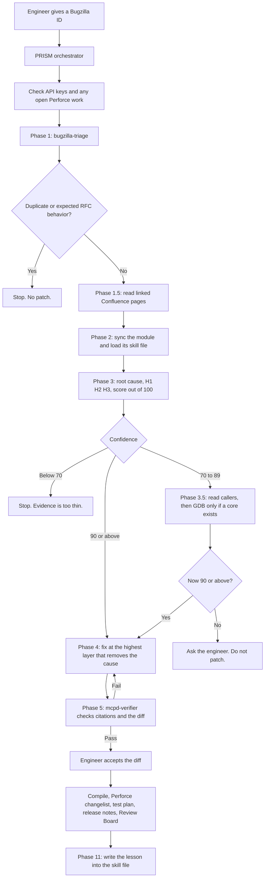

# PRISM

PRISM is an orchestrated bug-fix system for F5 BIG-IP’s control plane. An engineer gives it a Bugzilla bug ID. It triages the bug, proves a root cause from source and evidence, and only then writes a small patch, a test plan, and a review. If it cannot prove the cause, it stops and asks.

The control-plane daemon this targets is **mcpd**. It applies configuration, including authorization. Crashes and logic bugs there are SIGSEGV, SIGABRT, and authz defects. Before PRISM, an engineer did that whole path by hand: read the bug, hunt duplicates, trace C++ across modules, guess a cause, patch, compile, and open a review. PRISM keeps the engineer in charge of the risky decisions and does the repeatable investigation.

The line to repeat if you blank: **PRISM may investigate on its own. It may patch only at 90, only after a verifier passes, and only after the engineer accepts the diff.**

## What it solves

| Before | With PRISM |
|---|---|
| Engineer repeats triage, duplicate search, source trace, patch, compile, and review by hand | One workflow produces the evidence chain, patch draft, test plan, and review description |
| A model (or a person) can guess a cause when the backtrace is thin | A confidence gate blocks the patch until the cause is cited |
| A wrong mcpd patch is expensive | The engineer accepts the diff before Perforce is edited |

PRISM is scoped to BIG-IP control-plane defects, especially mcpd crashes and authz bugs. It does not merge code by itself. Compile can be skipped by the engineer. It writes a test plan rather than running the full BIG-IP regression.

## Architecture

### Who does what

| Piece | Job |
|---|---|
| **PRISM** | Runs the phases in order. Holds the gates. Talks to the engineer. |
| **bugzilla-triage** | Fetches the bug, searches for duplicates, checks the component against the backtrace, and checks whether the behavior is required by an RFC. |
| **mcpd-debug** | Runs only when confidence is still under 90 and a core dump exists. Uses GDB on a dev host. |
| **mcpd-verifier** | A separate agent. It does not see PRISM’s reasoning. It recomputes the score from raw evidence and tries to disprove the hypothesis. Three failures send the bug back to the engineer. |

External systems: Bugzilla, Confluence, Review Board, Perforce, the local workspace, module skill files, and GDB when a core exists.

The rule in the agent is **proof or ask**. A claim needs a `file:line`, a backtrace frame, or a direct quote.

## How a bug moves through it

1. **Session start.** Check API keys. If Perforce already has open files or a pending changelist, resume that work. Do not create a second changelist or a second review.
2. **Phase 1 — Triage.** `bugzilla-triage` fetches the summary, comments, backtrace, duplicates, component, and related bugs. A duplicate, or behavior an RFC requires, stops the run.
3. **Phase 1.5 — Confluence.** Read design pages linked from the bug and pass that context forward.
4. **Phase 2 — Code and skills.** Sync the crashing module into the local workspace. Load that module’s skill file. Analysis uses local files. Perforce is for fetching skills and syncing a missing path once.
5. **Phase 2.5 — Third-party check.** If the crash is inside an upstream library, check that before blaming BIG-IP code.
6. **Phase 3 — Root cause.** Regression check first. Then read the crashing function, trace the path from the entry point, name the bad value, and form H1 plus two alternatives. Actively try to disprove H1. Score the evidence.
7. **Phase 3.5 — Confidence boost.** Only when the score is 70–89. Read dependent modules. Use `mcpd-debug` only for a core. If still under 90, ask the engineer and do not patch.
8. **Phase 4 — Fix.** Choose the highest layer that removes the cause. Show options when more than one is valid. Wait for the engineer.
9. **Phase 5 — Verifier.** `mcpd-verifier` audits the evidence chain and the diff. A failure goes back to the fix.
10. **Phase 5.5 — Accept and edit.** The engineer accepts the diff. Then `p4 edit` (or the hotfix branch flow on a maintenance branch).
11. **Phase 6 — Compile.** Confirm the build command. Compile in a detached tmux session. The engineer may skip this.
12. **Phase 7–10 — Ship the review.** Changelist, test plan, release notes, Review Board.
13. **Phase 11 — Learning.** Write the defect pattern, a debug trick, or a workflow correction into the skill file or the agent so the next bug is faster.

### Confidence thresholds

| Score | What happens |
|---|---|
| **Under 70** | Stop. Do not keep a hypothesis. Ask for more evidence. |
| **70 to 89** | Keep investigating. Read callers and dependent modules. Use GDB only if a core exists. |
| **90 or above** | Allowed to write a fix. |
| **Engineer override** | The engineer can explicitly continue below 90. The override is recorded. |

Scoring rubric (100 points), from `references/confidence-scoring.md`:

| Points | Criterion |
|---|---|
| +15 | Crash location matches the backtrace at `file:line` |
| +15 | Faulting variable or condition traced to its origin |
| +10 | Exact trigger condition |
| +10 | Alternatives ruled out with evidence |
| +10 | Evidence chain has no gaps |
| +10 | Skill file confirms or rules out a known pattern |
| +10 | Code path traced from entry point to crash |
| +5 | Related bugs confirm the same cause |
| +5 | Primary hypothesis uses definitive language |
| +5 | Same pattern found elsewhere |
| +5 | Callers assume the invariant that was violated |

### Fix ranking

| Tier | What it is |
|---|---|
| **1 — Architectural** | Restore the invariant that should have prevented the bad state. Preferred. |
| **2 — Structural** | Fix ownership, data flow, or transaction scope so the bad state cannot reach the crash. |
| **3 — Defensive and recovery** | A guard at the crash site plus recovery for state that already exists. Used with tier 1 when old state may already be present. |
| **4 — Workaround** | Hides the symptom. Forbidden unless the engineer signs off. |

Before the diff is shown, PRISM checks callers, return-value impact, thread safety, MVCC, high availability and config sync, backward compatibility, sibling paths, and skill-file guidance.

### What the verifier checks

Deterministic checks run first. Any failure stops the gate:

- Every finding has a real source citation
- The primary hypothesis has no weasel words (`probably`, `likely`, `might`, `seems`)
- Every `file:line` exists in the workspace
- An independent rescore is within 5 points of the claimed score
- GDB interpretation matches the raw debugger output
- The diff matches the claimed files and lines, and new error paths are logged
- No unbounded loop waiting on a third party
- A pattern copied from startup code is not applied on a request path

If those pass, a second pass judges the raw evidence without seeing PRISM’s reasoning and tries to disprove H1. Three failures escalate to the engineer.

## The resume metric

The resume says defect cycle time went from 30 days to 10 days (66%). This repository does not contain that measurement. If an interviewer asks, define the clock as time from bug assignment to a reviewable patch, name the sample, and say what stayed human: accepting the diff, compile, and review. Do not invent a sample size in the room.

## Interview answers

Speak each answer in about a minute. **STAR** means Situation, Task, Action, Result.

### 1. What is PRISM, and why did you build it?

- **Situation.** BIG-IP control-plane bugs sat with engineers who repeated the same path: Bugzilla, duplicate search, C++ trace, patch, compile, review. mcpd crashes and authz bugs were slow because the code and the history are large.
- **Task.** Shorten that path while keeping a human responsible for a wrong patch.
- **Action.** I built PRISM as an orchestrator with three specialists and hard gates. Triage can stop the run. A confidence score below 90 blocks the patch. A separate verifier checks citations. The engineer accepts the diff before Perforce is edited.
- **Result.** The investigation, the evidence chain, the patch draft, the test plan, and the review description come out of one workflow. The engineer spends time on the judgment calls.

### 2. Why is it called PRISM?

The agent files never expand PRISM into an acronym. Do not invent one in the interview.

- **Situation.** The workflow needed a name that matched what it does: take one opaque bug and separate it into evidence you can inspect.
- **Task.** Pick a name people can remember, without pretending it is a formal acronym.
- **Action.** A prism takes one mixed beam and separates it into distinct bands. PRISM does that with a Bugzilla bug: triage, source, hypotheses, a score, and a patch. A patch is allowed only when that picture is clear, which means a confidence score of 90, a passing verifier, and the engineer accepting the diff. The related name in the code is SAGE. Those are the module skill files PRISM loads before it analyzes a crash. SAGE holds the knowledge. PRISM is the workflow that uses it.
- **Result.** If they ask what it stands for, say it is a name, then give that explanation. Do not spell out letters that are not in the repo.

### 3. Walk me through what happens for one bug.

- **Situation.** An engineer has a Bugzilla ID and a workspace with Perforce.
- **Task.** Produce a minimal, reviewable fix with a proven cause.
- **Action.** PRISM checks API keys, then asks bugzilla-triage to fetch the bug. A duplicate or RFC-expected behavior ends the run. Otherwise it reads linked Confluence pages, syncs that module locally, and loads the module skill file. Root-cause analysis forms one primary hypothesis and two alternatives, and scores the evidence. Under 90, it reads more code or, for a core, calls mcpd-debug. At 90 it drafts a fix at the highest layer that removes the cause. mcpd-verifier audits the evidence and the diff. The engineer accepts it. Then compile, changelist, test plan, release notes, Review Board, and a learning written back to the skill file.
- **Result.** One bug leaves with a cited root cause, a gated patch, and a review. A weak bug leaves with a question, not a guess.

### 4. Why can the system refuse to write a fix?

- **Situation.** A model will happily invent a root cause when the backtrace is incomplete.
- **Task.** Make “I don’t know yet” a successful outcome.
- **Action.** Phase 3 scores ten criteria: crash line matched, bad value traced, trigger named, alternatives disproved, every step cited, skill file checked, full path traced, related bugs, precise language, caller assumptions. Below 70, it stops. From 70 to 89, Phase 3.5 gathers more evidence. Still under 90, it asks for logs, a core, or a specific file. Phase 4 does not run.
- **Result.** The gate is the product. A wrong patch in mcpd is more expensive than a day of waiting.

### 5. Why several agents instead of one long prompt?

- **Situation.** Triage, C++ debugging, and skepticism are different jobs. One context window also loses state on a long bug.
- **Task.** Keep each role narrow and keep the verifier honest.
- **Action.** bugzilla-triage only handles Bugzilla, duplicates, component mapping, and RFC checks. mcpd-debug only runs GDB when a core exists and confidence is still low. mcpd-verifier is not allowed to see PRISM’s reasoning. It recomputes the score from raw evidence and must try to disprove the hypothesis. PRISM owns the sequence and the resume protocol, because a dropped session used to risk a second changelist or a second review.
- **Result.** A failure has a phase to return to. The verifier cannot rubber-stamp the orchestrator’s story.

### 6. How do you catch a hallucinated root cause?

- **Situation.** The model can cite a line that does not exist, or say “likely” when the evidence is thin.
- **Task.** Fail closed before any file is edited.
- **Action.** The verifier runs deterministic checks first: every finding has a source, the primary hypothesis has no weasel words, every `file:line` exists, the score matches the rubric within 5 points, GDB text matches the interpretation, and the diff touches only the claimed lines. New error paths must be logged. An unbounded loop fails. A pattern copied from startup code into a request path fails. Only if those pass does a second pass judge the evidence with no access to PRISM’s write-up. Three failures escalate to the engineer.
- **Result.** A patch cannot proceed on a paraphrase. It proceeds on a citation the verifier could open.

### 7. Tell me about a design change that came from a real run.

- **Situation.** On bug 2053441, depot-wide `p4 grep` was slow and failed because every search crossed the network.
- **Task.** Make code reading reliable for later bugs.
- **Action.** The learning was written into the agent. Perforce is used to fetch skill files and to sync a missing path once. Grep, read, and analysis then use the local workspace only.
- **Result.** Later runs search local files. The lesson is in the workflow, so the next session does not rediscover it.

Use a second bug of your own here if you remember the ID, the score, and whether the gate blocked. That story is stronger than this one if you can tell it cleanly.

### 8. How do you decide the shape of the fix?

- **Situation.** The obvious edit is often a null check at the crash site. The bad state was created earlier.
- **Task.** Fix the origin, and also survive state that is already corrupt.
- **Action.** PRISM ranks options. First choice is the invariant that should have blocked the bad state. Second is ownership or transaction scope. A defensive handler is added when old state may already be in memory or in config sync, and it is paired with the upstream fix. Before the diff is shown, callers, thread safety, MVCC, high availability, and sibling paths are checked. The engineer must accept the diff. Compile runs only after they confirm the build command.
- **Result.** The review contains the cause, the layer that was fixed, and a test plan: regression, success path, boundary, error path, and HA or concurrency when those apply.

### 9. What did you own, versus what the model did?

- **Situation.** The role asks for ownership, not a demo of a framework.
- **Task.** Be able to say which decisions were yours.
- **Action.** Say this in your own words, then stick to it. You owned the phase design, the 70 and 90 gates, the rule that the verifier cannot see the orchestrator’s reasoning, the fix ranking, and the human accept step before `p4 edit`. The model drafts triage, evidence, and the patch inside those rules.
- **Result.** You can defend a trade-off. You are not claiming the model merged code on its own.

## Scaling and challenges

### 10. This works for one engineer and one bug. How do you scale it?

- **Situation.** Each run is sequential, interactive, and tied to one workspace and one Perforce client.
- **Task.** Let many bugs move without an engineer watching every phase.
- **Action.** Put bugs on a queue. One worker per bug through triage and root cause, which are read-only. Pause any bug under 90 for a human. Auto-continue only at 90 with a passing verifier. Compile in CI instead of an interactive tmux session. Keep Perforce edits and Review Board creation on the accept step. Store evidence, score, and diff so a new session resumes without redoing phases. That resume protocol already exists for one session. The queue is the missing layer.
- **Result.** Engineers review a short list of blocked bugs and accepted patches. They stop babysitting every phase.

### 11. What breaks first?

- **Context loss.** A long bug already needed a resume protocol so the agent would not open a second changelist. At higher volume that state has to live in a database, not in the chat.
- **Module knowledge.** Quality depends on skill files and a local sync of that module. A daemon with no skill file drops confidence and stops. That is safe, and it caps coverage.
- **Core debugging.** mcpd-debug needs a core path, symbols, and a dev host. Most bugs do not have that, so they depend on source tracing alone.
- **Human gates.** Accept, compile confirm, and release notes are manual on purpose. They limit throughput.
- **Search cost.** Depot-wide search was already slow enough to ban. Scaling means local indexes, not more Perforce greps.
- **Verifier sharing a model family with the writer.** Isolation of the prompt is there. A different checker, or a deterministic checker plus a second model, is the next hardening step.

Pick two of these in the interview and talk about them.

### 12. How would you know the confidence score is real?

- **Situation.** A rubric can look strict and still be overconfident.
- **Task.** Calibrate 90 against bugs whose cause is already known.
- **Action.** Take historical bugs with a known root cause and a submitted fix. Run PRISM with the fix hidden. Record the score, whether H1 matches the real cause, and whether a score under 90 would have stopped a wrong H1. Track false stops too: correct cause, score under 90. Adjust the rubric from that set. Reviewer comments in Phase 11 are the live signal. A reviewer rejecting the cause is a missed gate.
- **Result.** 90 means “this matched held-out bugs,” not “the prompt told itself it was sure.”

### 13. How would you take this beyond mcpd?

- **Situation.** Subagents, skill paths, and the build target `mcpd-x86_64` are specific to this daemon.
- **Task.** Keep the gates, replace the domain knowledge.
- **Action.** The portable parts are the orchestrator, the evidence schema, the two thresholds, the isolated verifier, and the accept-before-edit rule. The replaceable parts are the triage source, the skill files, and the debug tool. A new service gets its own skill file and its own test command. It does not get a weaker gate.
- **Result.** The company can reuse the control system. It should not copy mcpd’s GDB steps onto an unrelated backend.

### 14. What would you do differently if you started again?

- Persist phase state outside the chat from day one.
- Build the calibration set before tuning the rubric.
- Run compile in CI with a fixed command, and keep the human gate only on the diff.
- Measure time-to-reviewable-patch per bug from the first week, so the 30-day to 10-day claim has a defined sample.

Say one of these, and mean it.

## Where this lives in the repo

| Path | What it is |
|---|---|
| `ai-agents/projects/PRISM/agents/PRISM.agent.md` | Orchestrator and phase workflow |
| `ai-agents/projects/PRISM/references/confidence-scoring.md` | Scoring rubric |
| `ai-agents/projects/PRISM/subagents/bugzilla-triage/` | Triage agent |
| `ai-agents/projects/PRISM/subagents/mcpd-debug/` | Core-dump debug agent |
| `ai-agents/projects/PRISM/subagents/mcpd-verifier/` | Independent verifier |
